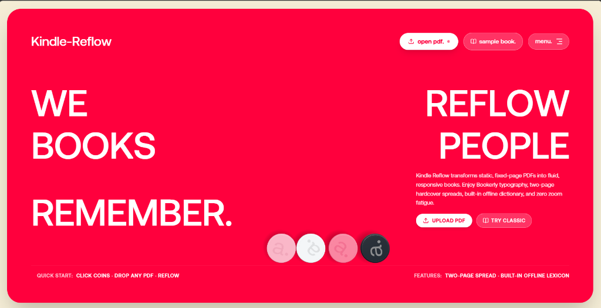

# Kindle Reflow — Mobile-First PDF E-Reader

[](https://kindle-reflow.vercel.app)
[](LICENSE)
[](https://react.dev/)
[](https://tailwindcss.com/)

> **Experience the Live App:** [**kindle-reflow.vercel.app**](https://kindle-reflow.vercel.app)

---

## 📸 Preview



---

## 🌟 What is Kindle Reflow?

Instead of treating PDFs like rigid, unreadable canvas sheets where you have to constantly pinch, zoom, and pan around columns on your phone, **Kindle Reflow** extracts, structures, and reflows document text into responsive, discrete ebook pages that wrap naturally to any mobile, tablet, or laptop display.

Featuring an **Awake Agency-inspired aesthetic**, interactive 3D physics coins, Bookerly typography, offline dictionary definitions, and a 10x-accelerated client-side extraction engine.

---

## ✨ Key Features

### 📖 True Kindle Reading Feel
- **Reflowable Text Wrapping**: Extracted text reflows into elegant book columns. Never pinch-and-pan again.
- **High-Speed Extraction Engine**: Parses multi-hundred page PDFs in seconds with concurrent batch decoding, automatic memory cleanup, and throttled UI updates.
- **Section Chunking for Big Books**: Only the active section is rendered in the DOM, keeping memory footprint minimal and rendering butter-smooth even on 500+ page books.
- **Kindle Pagination Engine**: Discrete horizontal pages (no infinite web scrolling). Recalculates page counts on font resize or orientation change while maintaining your relative reading position.
- **Desktop Two-Page Spread**: Optional facing-page layout on laptops and tablets.

### 👆 Intuitive Mobile & Laptop Controls
- **Touch Swipe**: Swipe left/right on mobile screens for smooth page flips.
- **Edge Taps**:
  - Tap **right 25%** to turn to the next page.
  - Tap **left 22%** to turn to the previous page.
  - Tap **center 53%** to toggle the top toolbar, typography settings, and bottom scrubber.
- **Keyboard Navigation**:
  - `ArrowRight`, `Spacebar`, `PageDown`: Next page
  - `ArrowLeft`, `PageUp`: Previous page
  - `Escape`: Toggle toolbars

### 🎨 Bookerly Typography & Themes
- **Font Families**: Bookerly / Literata (Kindle's signature book serif), Merriweather, Amazon Ember / Sans-Serif, and JetBrains Mono.
- **Themes**:
  - **Light**: Crisp paper white with contrast ink.
  - **Sepia**: Warm parchment background with soothing dark bistre typography.
  - **Dark**: Deep OLED charcoal with muted warm text for nighttime reading.
- **Text & Margin Controls**: Font size adjustments (12px to 32px), line spacing (Tight, Normal, Relaxed), and margins (Compact, Normal, Wide).

### 📚 Offline Lexicon & Memory
- **Built-in Offline Dictionary**: Instant word definitions, phonetic pronunciations, and Datamuse fallback with zero network calls required.
- **Table of Contents (TOC)**: Extracted PDF outlines and chapter headings with instant navigation links.
- **Ribbon Bookmarks**: Tap the bookmark ribbon in the top-right corner to bookmark any page with snippet preview and timestamp.
- **Reading Progress Scrubber**: Interactive slider to jump across the entire book (0% to 100%) with live chapter titles and "minutes left in chapter" estimation.
- **State Persistence**: Remembers your exact reading position, bookmarks, font size, theme, and cached books using browser IndexedDB.

### 🔒 100% Client-Side Privacy
- Runs **entirely in your browser**.
- Zero cloud uploads, zero external telemetry, zero servers.
- Parsed documents and settings remain in your device's local storage.

---

## 🌐 Live Access

You can open and use the application directly on your phone, tablet, or desktop:

👉 [**https://kindle-reflow.vercel.app**](https://kindle-reflow.vercel.app)

---

## 🚀 Quick Start (Local Development)

### 1. Clone & Install Dependencies
```bash
git clone https://github.com/ankitbhartii/Kindle-Reflow.git
cd Kindle-Reflow
npm install
```

### 2. Start Development Server
```bash
npm run dev
```
Open your browser at `http://localhost:5173`.

### 3. Build for Production
```bash
npm run build
npm run preview
```

---

## 🛠️ Architecture Overview

- **`src/services/pdfParser.ts`**: High-performance batch extraction with PDF.js web worker, memory lifecycle cleanup, median font-size detection, heading classification, and section chunking.
- **`src/services/storage.ts`**: IndexedDB abstraction (`idb-keyval`) for storing book content, reading progress, and typography preferences without 5MB localStorage limits.
- **`src/services/sampleBook.ts`**: Bundled classic book (*"The Time Machine"* by H. G. Wells) ready to read immediately.
- **`src/components/HeroCoins.tsx`**: Matter.js 2D rigid-body physics engine simulating tumbling debossed coins cascading across typographic obstacles.
- **`src/components/KindleReader.tsx`**: Screen-fitting CSS multi-column pagination engine, swipe/edge-tap gesture detector, and floating Kindle toolbars.
- **`src/components/ContentsDrawer.tsx`**: Chapter outline, bookmarks manager, and reading statistics.
- **`src/components/FontSettingsModal.tsx`**: Typography, themes, spacing, and two-page spread toggles.
- **`src/components/KindleProgressScrubber.tsx`**: Smooth reading slider and footer statistics.

---

## 📄 License

This project is licensed under the [MIT License](LICENSE).
